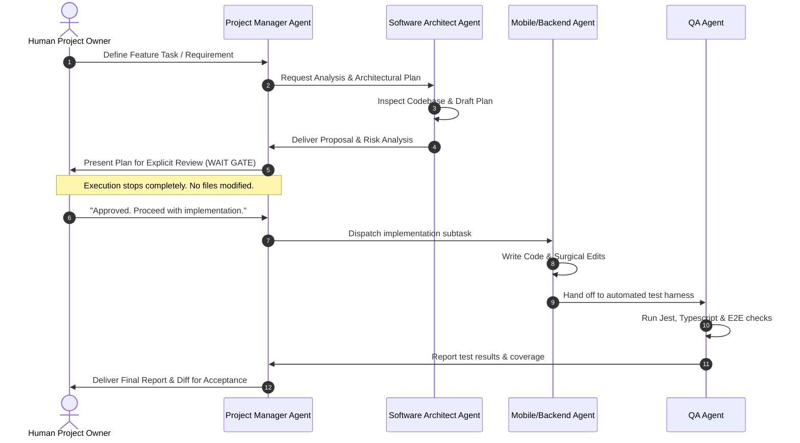

# Multi-Agent Workflow & Governance Protocols

## 1. Antigravity Agent Lifecycle & Gate Control

---

## 2. Hard Stop Protocol & Guardrails

1. **The "Wait Gate" is Inviolate**: An agent must conclude its turn immediately after presenting an implementation plan requiring human approval. It must never append implementation code to the planning turn.
2. **Context Window Protection**: Agents should not read massive log files or bundle dumps. They use surgical line reads (`read_file` with ranges).
3. **No Phantom Tools**: Agents must strictly use the native tools declared in the Antigravity environment (`read_file`, `write_file`, `edit_file`, `run_command`, `schedule`, `search_marketplace`, `swarm`).
