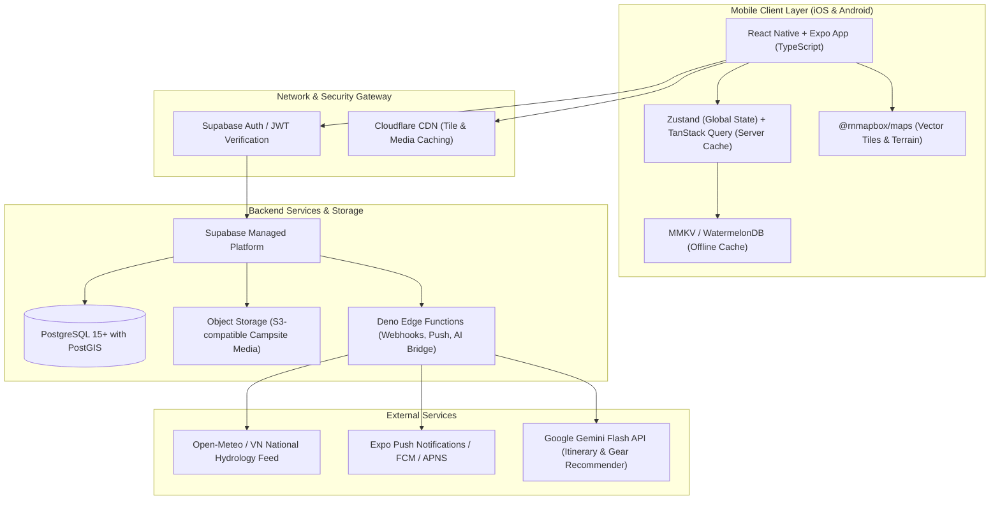

# System Architecture Specification

## 1. High-Level Architecture Diagram



---

## 2. Core Architectural Decisions

### 2.1 Geospatial Engine (PostGIS)
All spatial coordinates are stored in standard `GEOMETRY(Point, 4326)`. Spatial queries compute:
- Campsites within radius $R$ from user current GPS coordinates:
  ```sql
  SELECT id, name, ST_Distance(location, ST_SetSRID(ST_MakePoint(lon, lat), 4326)::geography) AS distance_meters
  FROM campsites
  WHERE ST_DWithin(location, ST_SetSRID(ST_MakePoint(lon, lat), 4326)::geography, 50000)
  ORDER BY distance_meters ASC;
  ```
- Fast bounding-box queries for viewport-based map rendering.

### 2.2 Offline Resilience Model
- When users view a campsite or save it to favorites, the campsite profile, emergency contacts, offline driving directions, and localized map thumbnail are cached in local MMKV/SQLite.
- If cell connection drops (common in Northern mountain passes), the app transparently shifts to reading from the local cache.

### 2.3 Security & Row Level Security (RLS)
- Public read access for verified campsite records (`verification_level >= 2`).
- Strict RLS on private user profiles, emergency contacts, draft reviews, and saved locations.
- Sensitive user locations are never broadcast publicly; companion finder shares only coarse city/district locations until mutually accepted.
