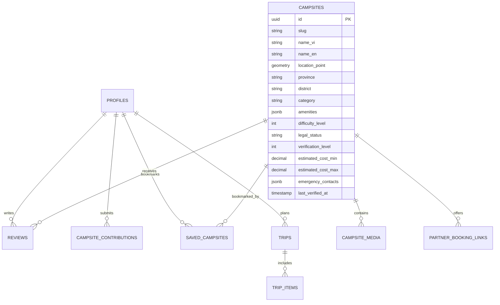

# Database Schema Specification (PostgreSQL + PostGIS)

## 1. Entity-Relationship Overview



---

## 2. Table Definitions (PostgreSQL DDL)

```sql
-- Enable PostGIS extension
CREATE EXTENSION IF NOT EXISTS postgis;
CREATE EXTENSION IF NOT EXISTS "uuid-ossp";

-- 1. User Profiles
CREATE TABLE public.profiles (
    id UUID PRIMARY KEY REFERENCES auth.users(id) ON DELETE CASCADE,
    full_name TEXT NOT NULL,
    avatar_url TEXT,
    phone_number TEXT,
    bio TEXT,
    experience_level TEXT DEFAULT 'beginner' CHECK (experience_level IN ('beginner', 'intermediate', 'expert')),
    is_verified_camper BOOLEAN DEFAULT FALSE,
    created_at TIMESTAMPTZ DEFAULT NOW(),
    updated_at TIMESTAMPTZ DEFAULT NOW()
);

-- 2. Campsites
CREATE TABLE public.campsites (
    id UUID PRIMARY KEY DEFAULT uuid_generate_v4(),
    slug TEXT UNIQUE NOT NULL,
    name_vi TEXT NOT NULL,
    name_en TEXT,
    description_vi TEXT NOT NULL,
    description_en TEXT,
    category TEXT NOT NULL CHECK (category IN ('glamping', 'managed_campsite', 'wild_camping', 'homestay_camping')),
    location GEOMETRY(Point, 4326) NOT NULL,
    latitude DOUBLE PRECISION NOT NULL,
    longitude DOUBLE PRECISION NOT NULL,
    elevation_meters INT,
    province TEXT NOT NULL,
    district TEXT NOT NULL,
    address_detail TEXT,
    access_vehicle TEXT[] DEFAULT ARRAY['motorbike', 'car_4seats'], -- motorbike, car_4seats, suv_4wd, trek_only
    amenities JSONB DEFAULT '{
        "has_toilet": false,
        "has_clean_water": false,
        "has_electricity": false,
        "has_cell_signal": false,
        "allows_campfire": true,
        "pet_friendly": true,
        "trash_bin_available": false
    }'::JSONB,
    difficulty_level INT DEFAULT 1 CHECK (difficulty_level BETWEEN 1 AND 5),
    legal_status TEXT DEFAULT 'requires_permission' CHECK (legal_status IN ('public_legal', 'commercial_private', 'national_park_permit', 'requires_permission', 'restricted')),
    verification_level INT DEFAULT 1 CHECK (verification_level BETWEEN 1 AND 3),
    confidence_score DECIMAL(3, 2) DEFAULT 0.50,
    estimated_cost_min NUMERIC(12, 2) DEFAULT 0,
    estimated_cost_max NUMERIC(12, 2) DEFAULT 0,
    currency TEXT DEFAULT 'VND',
    emergency_contacts JSONB DEFAULT '[]'::JSONB,
    source TEXT DEFAULT 'editorial', -- editorial, community, partner
    is_active BOOLEAN DEFAULT TRUE,
    last_verified_at TIMESTAMPTZ DEFAULT NOW(),
    created_at TIMESTAMPTZ DEFAULT NOW()
);

-- Spatial Index for Fast Map Queries
CREATE INDEX idx_campsites_location ON public.campsites USING GIST(location);
CREATE INDEX idx_campsites_province ON public.campsites(province);
CREATE INDEX idx_campsites_verification ON public.campsites(verification_level);

-- 3. Campsite Media
CREATE TABLE public.campsite_media (
    id UUID PRIMARY KEY DEFAULT uuid_generate_v4(),
    campsite_id UUID REFERENCES public.campsites(id) ON DELETE CASCADE,
    media_url TEXT NOT NULL,
    media_type TEXT DEFAULT 'image' CHECK (media_type IN ('image', 'video')),
    caption TEXT,
    is_cover BOOLEAN DEFAULT FALSE,
    sort_order INT DEFAULT 0,
    created_at TIMESTAMPTZ DEFAULT NOW()
);

-- 4. Commercial Partner Booking Links
CREATE TABLE public.partner_booking_links (
    id UUID PRIMARY KEY DEFAULT uuid_generate_v4(),
    campsite_id UUID REFERENCES public.campsites(id) ON DELETE CASCADE,
    partner_name TEXT NOT NULL,
    partner_type TEXT NOT NULL CHECK (partner_type IN ('campground_operator', 'equipment_rental', 'local_tour_guide')),
    booking_url TEXT NOT NULL,
    contact_phone TEXT,
    contact_zalo TEXT,
    commission_rate DECIMAL(4, 2) DEFAULT 0.10,
    is_active BOOLEAN DEFAULT TRUE,
    created_at TIMESTAMPTZ DEFAULT NOW()
);

-- 5. Community Reviews
CREATE TABLE public.reviews (
    id UUID PRIMARY KEY DEFAULT uuid_generate_v4(),
    campsite_id UUID REFERENCES public.campsites(id) ON DELETE CASCADE,
    user_id UUID REFERENCES public.profiles(id) ON DELETE SET NULL,
    rating INT NOT NULL CHECK (rating BETWEEN 1 AND 5),
    cleanliness_score INT CHECK (cleanliness_score BETWEEN 1 AND 5),
    road_condition_score INT CHECK (road_condition_score BETWEEN 1 AND 5),
    safety_score INT CHECK (safety_score BETWEEN 1 AND 5),
    content TEXT NOT NULL,
    visited_at DATE NOT NULL,
    images TEXT[] DEFAULT ARRAY[]::TEXT[],
    is_verified_stay BOOLEAN DEFAULT FALSE,
    created_at TIMESTAMPTZ DEFAULT NOW()
);
```

---

## 3. Human Approval Requirement
This database schema is presented for architectural review. Applying these migrations to a live database requires explicit human authorization.
