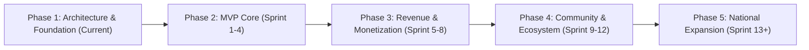

# Product Roadmap & Phased Execution

## Phase 1: Foundation & Architecture Setup (Current)
- [x] Multi-Agent governance established in `AGENTS.md`.
- [x] Full architectural documentation suite drafted.
- [x] Tech stack evaluated (React Native + Expo + Supabase/PostGIS).
- [x] Northern Vietnam geographical and supply-side strategy mapped.
- [ ] **Milestone Gate**: Human Project Owner Sign-Off on Architecture & Stack.

## Phase 2: MVP Core — Location Discovery & Verification (Sprints 1–4)
- **Sprint 1: Mobile Scaffolding & Design System**: Expo setup, navigation shell, bilingual i18n setup, theme tokens.
- **Sprint 2: Authentication & User Profiles**: Phone OTP / Google Auth via Supabase, user profiles, favorite locations.
- **Sprint 3: Map Discovery & Search Engine**: Mapbox integration, GPS location tracking, Northern provinces seed data (50 verified campsites), filtering by amenities.
- **Sprint 4: Campsite Detail & Moderation**: Campsite detail screens, road access guides, offline caching for saved sites, basic admin review portal.
- **Milestone Gate**: Internal Dogfooding in Hanoi & Soc Son campsites.

## Phase 3: Early Commercialization & Planning Tools (Sprints 5–8)
- **Sprint 5: Trip Planner & Smart Checklist**: Automated pack list based on terrain and weather; budget calculator.
- **Sprint 6: Partner Booking Redirection & Affiliate**: "Book Spot" or "Rent Equipment" deep links to verified partners; lead capture.
- **Sprint 7: Community Reviews & Photo Contributions**: User submission flow, moderation queue, verified camper badges.
- **Sprint 8: Local Weather & Safety Alerts**: Hyper-local weather forecast, flash-flood warning badges for mountain areas.
- **Milestone Gate**: First 10 paying campground and gear-rental commercial partners signed in Northern Vietnam.

## Phase 4: Community, Connect & AI Trip Assistant (Sprints 9–12)
- Social feed for camp trips, companion finder ("Tìm Bạn Cùng Đi"), camping event organizer.
- AI Trip Assistant (Gemini Flash API) generating customized weekend itineraries from Hanoi.
- Offline map pack downloads for low-connectivity provinces (Ha Giang, Lao Cai, Cao Bang).

## Phase 5: National Expansion & Premium Services (Sprint 13+)
- Geographic expansion to Central (Da Nang, Da Lat) and Southern Vietnam (Dong Nai, Vung Tau).
- Direct in-app payments, camping insurance micro-policies, branded outdoor brand marketplace.
